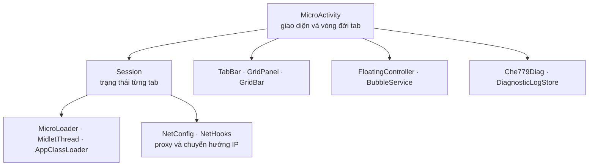

<div align="center">

# 📱 Che779 Android

**Chạy game J2ME (`.jar`) ngay trên điện thoại — nhiều game cùng lúc, mỗi game một tab.**

Dựa trên J2ME Loader, thêm lớp vỏ Che779: đa tab, chế độ lưới, bong bóng nổi, proxy theo tab và tiết kiệm pin.

[](#-cài-đặt)
[](#-cài-đặt)
[](LICENSE)
[](#-trạng-thái-và-giới-hạn)

[Tính năng](#-tính-năng) · [Cài đặt](#-cài-đặt) · [Cách dùng](#-cách-dùng-nhanh) · [Bản clone](#-tạo-bản-clone) · [Dành cho dev](#-dành-cho-nhà-phát-triển) · [Ghi công](#-ghi-công-và-giấy-phép)

</div>

---

## 🌐 Hệ sinh thái Che779

Che779 gồm 4 dự án, mỗi dự án một repo. Bạn đang xem **Project 4**.

| # | Dự án | Chạy trên | Dùng khi nào |
|:-:|---|---|---|
| 1 | [**Che779-Emulator**](https://github.com/Kidtomboy/Che779-Emulator) | Windows | Mỗi tab một cửa sổ, điều khiển bằng Remoter |
| 2 | [**Che779-EmulatorV2**](https://github.com/Kidtomboy/Che779-EmulatorV2) | Windows / Java 8+ | Nhiều tab trong một cửa sổ, một tiến trình |
| 3 | [**Che779-Linux**](https://github.com/Kidtomboy/Che779-Linux) | Linux và Termux | Gói chạy trên Linux và Android (Termux) |
| 4 | **Che779-Android** ← *bạn đang ở đây* | Android | Chạy trực tiếp trên điện thoại bằng APK |

---

## ✨ Tính năng

| | Tính năng | Mô tả |
|:-:|---|---|
| 🗂️ | **Đa tab** | Mỗi game là một phiên riêng trong cùng một ứng dụng; dữ liệu, mạng và hiển thị tách theo tab |
| 🔢 | **Số tab cố định** | Đóng tab 3 rồi mở lại vẫn là tab 3; dữ liệu tài khoản theo số tab, không trùng nhau |
| 🔲 | **Chế độ lưới** | Xem nhiều game cùng lúc dạng ô, chuyển qua lại giữa danh sách và lưới |
| 💬 | **Bong bóng nổi** | Thu game thành bong bóng, chạm để mở cửa sổ nổi; kéo vào ✕ để tắt, chạm đúp để mở app |
| ⌨️ | **Bàn phím ảo kiểu J2ME** | Bàn phím 12 phím dạng điện thoại, dùng được ở chế độ lưới và trong cửa sổ nổi |
| 🔁 | **Đồng bộ phím** | Chọn các tab cùng nhận một phím bấm (tick từng tab) |
| 🌐 | **Proxy theo tab** | HTTP / SOCKS5 riêng từng tab, gán hàng loạt từ danh sách |
| 🔀 | **Chuyển hướng IP** | Chuyển hướng địa chỉ máy chủ theo từng tab |
| 🔋 | **Tiết kiệm pin** | Bốn chế độ: Bình thường, Tiết kiệm, Siêu tiết kiệm, Headless; ô Cài đặt nhanh để đổi |
| 🧹 | **Quản lý bộ nhớ** | Tự dọn khi RAM thấp, cảnh báo, tạm dừng vẽ / ngủ màn hình |
| 🧬 | **Bản clone** | Tạo thêm bản cài độc lập với tên gói, tên app và thư mục dữ liệu riêng |

> Không giới hạn số tab — nhưng RAM và pin của máy mới là giới hạn thật. Nhiều tab cùng đi chung một địa chỉ IP vẫn có thể bị máy chủ game chặn; dùng proxy riêng cho từng tab nếu cần.

---

## 📥 Cài đặt

1. Mở mục **[Releases](../../releases)** và tải **`Che779-Android.apk`** ở bản `latest`.
   Nếu chưa có file ở đó, vào tab **Actions → Build Che779 APK**, chọn lần chạy xanh mới nhất và tải artifact **`Che779-Android-APK`** (giải nén nếu tải về dạng ZIP).
2. Cho phép cài ứng dụng từ nguồn ngoài Play Store khi Android hỏi.
3. Mở app, cấp quyền **hiển thị trên ứng dụng khác** nếu muốn dùng bong bóng nổi (một số hãng máy giấu mục này sâu trong Cài đặt).

| | |
|---|---|
| Gói mặc định | `com.che779.emulator` |
| Phiên bản | `0.0.0.2-android` (`versionCode 103`; bản CI có hậu tố `-dev-<số build>`) |
| Android | minSdk 21 · targetSdk 29 · compileSdk 34 |
| Thư mục dữ liệu | `J2ME-Che779` trong bộ nhớ máy (Android 10 trở xuống); Android 11 trở lên nằm trong `Android/data/<tên gói>/files` |

> ⚠️ Bản CI được ký bằng **khóa thử nghiệm công khai** để người dùng cài đè được các bản thử. Đây không phải khóa phát hành; đừng xem APK này là bản chính thức đã ký riêng. Khi cập nhật, giữ nguyên tên gói và chữ ký của bản đang cài.

---

## 🚀 Cách dùng nhanh

1. **Thêm game:** bấm nút chọn game trên thanh tab và chọn file `.jar`.
2. **Thêm tab:** bấm **＋** (nhân bản tab 1; chạm giữ để chọn game khác). Chạm giữ vào tên tab để đổi tên.
3. **Xem lưới:** đổi sang chế độ lưới để thấy nhiều game cùng lúc; chạm một ô để chọn tab.
4. **Bong bóng:** bật bong bóng nổi để vừa chơi vừa dùng app khác.
5. **Proxy:** vào menu để gán proxy cho từng tab hoặc cả nhóm.
6. **Thoát:** chọn *Thoát hết* hoặc *Đóng tab này*.

---

## 🧬 Tạo bản clone

Vào **Actions → Build clone APK → Run workflow** và điền ba ô:

| Ô | Quy tắc | Ví dụ |
|---|---|---|
| `app_id` | Tên gói nhiều đoạn, mỗi đoạn bắt đầu bằng chữ | `com.che779.emulatorv2` |
| `app_name` | 1–40 ký tự: chữ, số, dấu cách, `._()-` | `Che779 Emulator V2` |
| `data_dir` | 1–64 ký tự chữ/số/`.`/`_`/`-`, không chứa `..` | `J2ME-Che779v2` |

Bản clone ra ở mục Releases với thẻ `clone-<tên gói>`. Mỗi bản clone có dữ liệu riêng, nên cài trùng game ở hai bản sẽ tốn dung lượng gấp đôi.

---

## 🧭 Trạng thái và giới hạn

Đây là **bản thử nghiệm**. Mình ghi rõ những gì chưa chắc để bạn khỏi bất ngờ:

- Chưa tuyên bố tương thích mọi máy hoặc mọi game. Quyền hiển thị trên ứng dụng khác thay đổi theo hãng.
- **Bản ghép nhiều game con** (kiểu x6–x12) hiện chưa vào được game con.
- Bàn phím ảo mới chưa gõ chữ được vào ô nhập văn bản.
- Dọn luồng khi đóng tab dựa trên đoán theo tên lớp; hai game trùng tên lớp có thể ảnh hưởng nhau.
- Một lần build xanh trên CI không thay cho việc thử trên máy thật.

Danh sách đầy đủ nằm ở [`docs/`](docs).

---

## 🛠️ Dành cho nhà phát triển

<details>
<summary><b>Môi trường và lệnh build</b></summary>

- JDK 21 (Temurin trên CI) · Android SDK Platform 34 · Android NDK `25.1.8937393` · Gradle Wrapper 8.10.2 (Android Gradle Plugin 8.7.3).

```bash
./gradlew testDevDebugUnitTest assembleDevDebug
```

Windows: `gradlew.bat testDevDebugUnitTest assembleDevDebug`. APK nằm ở `app/build/outputs/apk/dev/debug/`. Tải mã nguồn không có `.git` vẫn cấu hình được: số build lấy từ `GITHUB_RUN_NUMBER`, nếu không có thì dùng `1`.

</details>

<details>
<summary><b>Ký bản release</b></summary>

Bản `release` **không** tự dùng khóa thử nghiệm. Muốn ký, cấp đủ bốn biến môi trường trong môi trường build tin cậy:

`CHE779_RELEASE_STORE_FILE` · `CHE779_RELEASE_STORE_PASSWORD` · `CHE779_RELEASE_KEY_ALIAS` · `CHE779_RELEASE_KEY_PASSWORD`

Không commit keystore hay mật khẩu. Thiếu các biến này thì release ra dạng chưa ký. Đừng đổi khóa của ứng dụng đã phát hành nếu còn cần cập nhật cài đè.

</details>

<details>
<summary><b>Kiến trúc</b></summary>



| Thành phần | Trách nhiệm |
|---|---|
| `shell/Session` | Ngữ cảnh dữ liệu và trạng thái của từng tab |
| `shell/MicroActivity` | Activity chính, nối giao diện với vòng đời các tab |
| `shell/MicroLoader`, `MidletThread` | Nạp MIDlet, điều phối vòng đời theo Session |
| `shell/AppClassLoader` | Class loader riêng cho từng game |
| `shell/NetConfig`, `org/microemu/cldc/NetHooks` | Proxy và chuyển hướng theo tab |
| `shell/FloatingController`, `BubbleService` | Cửa sổ game nổi và bong bóng |
| `shell/TabBar`, `GridPanel` | Thanh tab và chế độ lưới |
| `shell/Che779Diag`, `DiagnosticLogStore` | Nhật ký chẩn đoán có xoay vòng, giới hạn dump luồng |

`MicroActivity` vẫn là lớp lớn (~2.100 dòng) và là ứng viên tách tiếp; chỉ nên làm khi đã có test vòng đời. Xem thêm [`docs/ARCHITECTURE.md`](docs/ARCHITECTURE.md) và [`docs/AI_HANDOFF.md`](docs/AI_HANDOFF.md).

</details>

---

## 🙏 Ghi công và giấy phép

Che779 Android kế thừa **[J2ME Loader](https://github.com/nikita36078/J2ME-Loader)** của Nikita Shakarun và các cộng tác viên (Apache License 2.0). Một số ý tưởng giao diện và tính năng đến từ các bản mod cộng đồng: **Hùng Hero** (J2ME Loader v10) và **NST Tiến** (J2ME_NST). Giữ nguyên các thông báo bản quyền khi phân phối lại; xem [`LICENSE`](LICENSE) và [`NOTICE`](NOTICE).

<div align="center">

Làm bởi **Cherry** · [Báo lỗi](../../issues) · [Changelog](CHANGELOG.md)

</div>
