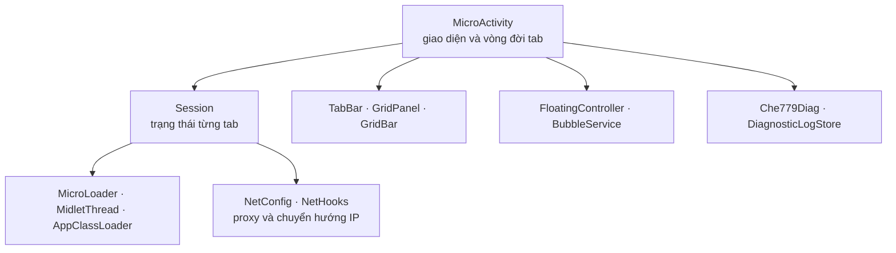

<div align="center">

# 📱 Che779 Android

**Chạy game J2ME (`.jar`) ngay trên điện thoại — nhiều game cùng lúc, mỗi game một tab.**

Dựa trên J2ME Loader, thêm lớp vỏ Che779: đa tab, chế độ lưới, bong bóng nổi, proxy theo tab và tiết kiệm pin.
Cài một file APK là dùng.

> **Nền tảng: Android.** Quy ước 4 repo: **P1 và P2 = Windows · P3 = Linux + Termux · P4 = Android**.

[](../../releases/latest)
[](../../releases)
[](../../actions)
[](#-yêu-cầu-hệ-thống)
[](LICENSE)

[Tải về](#-tải-về) · [Tính năng](#-tính-năng) · [Bắt đầu nhanh](#-bắt-đầu-nhanh) · [Hướng dẫn](#-hướng-dẫn-sử-dụng) · [Bản clone](#-tạo-bản-clone) · [Hỏi đáp](#-hỏi-đáp-và-xử-lý-lỗi) · [Dành cho dev](#-dành-cho-nhà-phát-triển) · [Tài liệu](#-tài-liệu) · [Ghi công](#-ghi-công-và-giấy-phép)

</div>

---

## 📥 Tải về

Vào mục **[Releases](../../releases/latest)** và tải file:

| File | Dùng để |
|---|---|
| `Che779-Android-<phiên bản>.apk` | Cài ứng dụng lên điện thoại Android |
| `Che779-Android-Clone-<phiên bản>.apk` | Bản clone (gói `com.che779.emulator2`, dữ liệu `J2ME-Che779Clone`) để cài song song với bản chính |
| `Che779-AndroidV2-<phiên bản>.apk` | Bản **V2** (dev-2.0.1): tên *Che779 Emulator V2*, gói `com.che779.emulatorv2`, dữ liệu `J2ME-Che779v2`; cài song song được với bản chính và bản clone. Nằm ở tag [`dev-2.0.1`](../../releases/tag/dev-2.0.1), kèm `SHA256SUMS.txt` riêng (bản thử, chưa phải bản ổn định) |
| `SHA256SUMS.txt` | Mã SHA-256 của các file trên (tính sau cùng, trên đúng file đăng). Kiểm tra: `sha256sum -c SHA256SUMS.txt` |

Mục Releases còn có bản **"thử mới nhất (dev, tự động)"** — cập nhật mỗi khi mã nguồn thay đổi, có thể chưa ổn định. Muốn dùng ổn định, hãy tải bản `vX.Y.Z`.

> ⚠️ APK được ký bằng **khóa thử nghiệm công khai** của dự án để các bản cài đè lên nhau được. Đây không phải khóa phát hành riêng: hãy chỉ tải từ Releases của repo này. Khi cập nhật, giữ nguyên tên gói và chữ ký của bản đang cài.

---

## 🌐 Hệ sinh thái Che779

Che779 gồm 4 dự án, mỗi dự án một repo. Bạn đang xem **Project 4**.

| # | Dự án | Chạy trên | Dùng khi nào |
|:-:|---|---|---|
| 1 | [**Che779-Emulator**](https://github.com/Kidtomboy/Che779-Emulator) | Windows | Mỗi tab một cửa sổ, điều khiển bằng Remoter |
| 2 | [**Che779-EmulatorV2**](https://github.com/Kidtomboy/Che779-EmulatorV2) | Windows | Nhiều tab trong một cửa sổ, một tiến trình |
| 3 | [**Che779-Linux**](https://github.com/Kidtomboy/Che779-Linux) | Linux | Gói `.deb` / `.tar.gz`: V2 + V1 + Remoter Linux |
| 4 | **Che779-Android** ← *bạn đang ở đây* | Android | APK chạy trực tiếp |

> 📌 Tên `Che779-Emulator` từng là tên của repo này. Nay bản Windows dùng tên đó; bản Android là **Che779-Android**. Link tải APK cũ (`…/Che779-Emulator.apk`) không còn dùng được — hãy tải từ [Releases](../../releases/latest).

---

## ✨ Tính năng

| | Tính năng | Mô tả |
|:-:|---|---|
| 🗂️ | **Đa tab** | Mỗi game là một phiên riêng trong cùng một ứng dụng; dữ liệu, mạng và hiển thị tách theo tab |
| 🔢 | **Số tab cố định** | Đóng tab 3 rồi mở lại vẫn là tab 3; dữ liệu tài khoản theo số tab, không trùng nhau |
| 🔲 | **Chế độ lưới** | Xem nhiều game cùng lúc dạng ô, chuyển qua lại giữa danh sách và lưới. Công tắc **Lấp đầy ô lưới** (Cài đặt): ô theo hình dạng game, 2–3 cột, quá 12 tab thì vuốt xuống |
| 🔄 | **Kiểm tra cập nhật** | Cài đặt → mục **Cập nhật**: kiểm tra Release mới trên GitHub (bản chính theo tag `v*`, V2 theo `dev-*`), tải APK, đối chiếu SHA-256 rồi mở trình cài đặt, cài đè giữ nguyên dữ liệu. Công tắc **Tự kiểm tra khi mở app** (mặc định tắt, tối đa 1 lần/ngày). Bản clone chỉ mở trang tải. |
| 💬 | **Bong bóng nổi** | Thu game thành bong bóng kéo được; chạm để mở cửa sổ nổi (đổi cỡ, thu nhỏ; công tắc **Lấp đầy cửa sổ nổi** cho cửa sổ co theo hình dạng game); kéo vào ✕ để tắt, chạm đúp để mở ứng dụng |
| ⌨️ | **Bàn phím ảo kiểu J2ME** | Bàn phím 12 phím dạng điện thoại, dùng ở chế độ lưới và trong cửa sổ nổi |
| 🔁 | **Đồng bộ phím** | Chọn các tab cùng nhận một phím bấm (tick từng tab) |
| 🌐 | **Proxy theo tab** | HTTP / SOCKS4 / SOCKS5 riêng từng tab. Dạng danh sách: form Host/Port/User/Pass + nút Kiểm tra; dạng lưới và cửa sổ nổi: bảng theo tab (chọn, sửa, xoá, tích bật/tắt, gán lần lượt). Nhập từ TXT/JSON/CSV hoặc dán; dữ liệu dùng chung giữa các dạng |
| 🔀 | **Chuyển hướng IP** | Chuyển hướng địa chỉ máy chủ theo từng tab (mục riêng, tách khỏi Proxy) |
| 🔋 | **Tiết kiệm pin** | 4 chế độ: Bình thường, Tiết kiệm, Siêu tiết kiệm, Headless; ô Cài đặt nhanh để đổi |
| ⏱️ | **Bộ đếm thời gian** | Thông báo hiện thời gian đã chạy (phút / giờ + phút / ngày + giờ), nút ⏱ giữa nút Chế độ và Dừng; chu kỳ cập nhật chọn trong Cài đặt (mặc định 5 phút) |
| 🧹 | **Quản lý bộ nhớ** | Treo (ngừng vẽ), ngủ màn hình, tự dọn khi RAM thấp, cảnh báo |
| 🧬 | **Bản clone** | Tạo thêm bản cài độc lập với tên gói, tên app và thư mục dữ liệu riêng |
| 🆕 | **Bản V2 (dev-2.0.1)** | Bản cài riêng (*Che779 Emulator V2*): danh sách game có nút **nguồn** (thoát hẳn) và nút **xoá** từng game (giữ vào game vẫn hiện công cụ J2ME); nút **Giao diện game** mở lưới ô, tab đầu "Mở game"; lấp đầy ô và cửa sổ nổi (công tắc, mặc định bật); "+" thêm ô "Mở game" khi bấm; mỗi ô có tiêu đề, ✕, proxy, dừng, phóng to; ✕ tab cuối thoát game, ✕ lần nữa báo không xoá được; **chế độ thêm game** thủ công hoặc tự động (nhớ cả khi thoát app) |

> Các tính năng chính (đa tab, lưới, bong bóng, treo/ẩn/ngủ, proxy theo tab, chuyển hướng IP) đã được chủ dự án thử trên máy thật. Những tính năng còn lại chưa có xác nhận — xem danh sách ở [`CHANGELOG.md`](CHANGELOG.md).
>
> Không giới hạn số tab, nhưng RAM và pin của máy mới là giới hạn thật. Nhiều tab cùng một địa chỉ IP vẫn có thể bị máy chủ game chặn; dùng proxy riêng cho từng tab nếu cần.

---

## 🖥️ Yêu cầu hệ thống

| | Yêu cầu |
|---|---|
| Android | **5.0 trở lên** |
| Bộ nhớ | Tùy số tab và game; mỗi tab chạy một game nên nhiều tab sẽ tốn RAM và pin |
| Quyền | **Hiển thị trên ứng dụng khác** (chỉ cần nếu dùng bong bóng nổi) |

---

## 🚀 Bắt đầu nhanh

1. Tải `Che779-Android-<phiên bản>.apk` ở [Releases](../../releases/latest).
2. Cho phép cài ứng dụng từ nguồn ngoài Play Store khi Android hỏi, rồi cài.
3. Mở ứng dụng, bấm nút chọn game và chọn file `.jar`.

---

## 📖 Hướng dẫn sử dụng

1. **Thêm game:** bấm nút chọn game trên thanh tab và chọn file `.jar`.
2. **Thêm tab:** bấm **＋** (nhân bản tab 1; chạm giữ để chọn game khác). Chạm giữ vào tên tab để đổi tên.
3. **Xem lưới:** đổi sang chế độ lưới để thấy nhiều game cùng lúc; chạm một ô để chọn tab.
4. **Bong bóng:** bật bong bóng nổi để vừa chơi vừa dùng ứng dụng khác. Một số hãng máy giấu mục cấp quyền "hiển thị trên ứng dụng khác" khá sâu trong Cài đặt.
5. **Proxy / IP:** menu có hai mục riêng. **Proxy**: ở dạng danh sách nhập Host, Port, User, Pass và chọn HTTP/SOCKS4/SOCKS5 (có nút Kiểm tra); ở dạng lưới hoặc cửa sổ nổi dùng bảng theo tab, có nhập file TXT/JSON/CSV. **Chuyển hướng IP**: giữ nguyên như cũ. Thay đổi áp dụng cho kết nối mới.
6. **Tiết kiệm pin:** đổi chế độ pin ở menu hoặc ô Cài đặt nhanh.
7. **Thoát:** chọn *Thoát hết* hoặc *Đóng tab này*.

---

## ⚙️ Cấu hình và nơi lưu dữ liệu

| | |
|---|---|
| Gói mặc định | `com.che779.emulator` |
| Thư mục dữ liệu | `J2ME-Che779` trong bộ nhớ máy (Android 10 trở xuống); Android 11 trở lên nằm trong `Android/data/<tên gói>/files` |
| Nhật ký chẩn đoán | `che779-diag.txt` (xoay vòng, tối đa 3 MiB mỗi thế hệ) — gửi file này khi báo lỗi |

Mỗi tab có dữ liệu riêng; bản clone có thư mục dữ liệu tách hẳn bản gốc.

---

## 💻 Termux

Đã chuyển sang repo **Che779-Linux** (`apps/termux/`), tải `che779-termux-v2.sh` (V2) hoặc `che779-termux-v1.sh` (V1) ở Releases của repo đó (thẻ `termux-v*`). Hướng dẫn: `apps/termux/README.md` trong repo đó.
## 🧬 Tạo bản clone

Muốn có thêm một bản cài độc lập (tên gói, tên ứng dụng và dữ liệu riêng)? Vào **Actions → Tạo bản clone → Run workflow** và điền ba ô:

| Ô | Quy tắc | Ví dụ |
|---|---|---|
| `app_id` | Tên gói nhiều đoạn, mỗi đoạn bắt đầu bằng chữ | `com.che779.emulator2` |
| `app_name` | 1–40 ký tự: chữ, số, dấu cách, `._()-` | `Che779 Emulator 2` |
| `data_dir` | 1–64 ký tự chữ/số/`.`/`_`/`-`, không chứa `..` | `J2ME-Che779Clone` |

Bản clone ra ở mục Releases với thẻ `clone-<tên gói>`. Mỗi bản clone có dữ liệu riêng nên cài trùng game ở hai bản sẽ tốn dung lượng gấp đôi.

---

## 🧩 Cách hoạt động



Phần lõi J2ME Loader lo các API MIDP/CLDC; Che779 thêm lớp vỏ đa phiên bao quanh. Mỗi tab là một `Session` có class loader, dữ liệu và cấu hình mạng riêng. Chi tiết: [`docs/ARCHITECTURE.md`](docs/ARCHITECTURE.md).

---

## ❓ Hỏi đáp và xử lý lỗi

| Bạn gặp | Làm gì |
|---|---|
| Không cài được APK | Cho phép cài từ nguồn ngoài Play Store. Nếu đang cài đè, bản cũ phải cùng tên gói và cùng chữ ký. |
| Không bật được bong bóng nổi | Cấp quyền **hiển thị trên ứng dụng khác** cho ứng dụng trong Cài đặt máy. |
| Bản ghép nhiều game con (x6…) không vào được | Từ v1.3.1 bản x6 đã chơi được. Nếu bản ghép khác vẫn lỗi, mở Issue kèm file `che779-diag.txt`. |
| Bàn phím J2ME gốc thụt xuống sau khi thoát chế độ lưới | Lỗi đã biết. Dùng mục menu **Sửa bàn phím ảo** hoặc bàn phím ảo của ứng dụng. |
| Game không vào được mạng | Thử gán proxy (menu **Proxy**) hoặc **Chuyển hướng IP** cho tab, rồi mở lại kết nối: proxy chỉ áp dụng cho kết nối mới. Nút **Kiểm tra** trong form proxy cho biết proxy có sống không. Lỗi mạng còn có thể do chính máy chủ game. |
| Bấm nhanh nhiều nút công cụ ra nhiều hộp thoại chồng nhau | Đã sửa ở 1.3.2: chỉ một hộp thoại tại một thời điểm, bấm khi đang có hộp thoại sẽ bị bỏ qua. |
| Muốn cập nhật mà không phải gỡ app | Vào **Cài đặt → Cập nhật → Kiểm tra cập nhật**; lần đầu Android sẽ hỏi cho phép cài ứng dụng từ app này. Cần cùng khoá ký với bản đang cài (các bản chính thức đều cùng khoá). |
| Ô lưới còn khoảng trống hai bên / bên dưới | Bật **Lấp đầy ô lưới** (và **Lấp đầy cửa sổ nổi**) trong Cài đặt ở màn hình chọn game. Nếu không đổi ngay, thoát hẳn game rồi mở lại lưới. |
| Đồng bộ tab thao tác lan sang tab khác | Đồng bộ tự tắt khi rời dạng lưới. Chỉ bật khi thật sự muốn các tab cùng nhận phím (tránh mua hàng nhầm ở tab khác). |
| Bong bóng biến mất khi kéo | Đừng thả bong bóng vào vùng ✕ ở giữa đáy màn hình. Cài đặt có mục chỉnh cỡ, độ mờ và chỉ hiện khi treo. |
| Quên thoát game, máy nóng hoặc hao pin | Bản V2: bấm nút **nguồn** ở danh sách game để thoát hẳn. Bản thường: menu **Thoát**. |
| Bản V2: không xoá được tab | Đúng thiết kế: không được xoá tab cuối cùng. Dùng nút nguồn để thoát hẳn. |
| Bản V2: thêm tab không hỏi game | Bạn đang ở chế độ thêm game **tự động**. Bấm giữ ô **+ Thêm tab** để chuyển lại thủ công. |
| Cài V2 hoặc clone báo xung đột | Mỗi bản có tên gói riêng (`com.che779.emulator`, `…emulatorv2`, `…emulator2`) và thư mục dữ liệu riêng; game cài ở bản này không tự thấy ở bản kia. |
| Muốn báo lỗi | Mở [Issue](../../issues/new/choose), ghi phiên bản, tên máy, Android và gửi `che779-diag.txt`. Xóa mật khẩu proxy khỏi log. |

---

## ⚠️ Giới hạn và vấn đề đã biết

- **Bản ghép nhiều game con**: bản x6 đã vào chơi được (chủ dự án xác nhận ở v1.3.1). Các bản ghép khác chưa có xác nhận.
- **Bàn phím J2ME gốc có thể thụt xuống** sau khi thoát lưới; đang che bằng bàn phím ảo mới.
- Bàn phím ảo mới chưa gõ chữ được vào ô nhập văn bản.
- Dọn luồng khi đóng tab dựa trên đoán theo tên lớp; hai game trùng tên lớp có thể ảnh hưởng nhau.
- Chưa tuyên bố tương thích mọi máy hoặc mọi game; quyền hiển thị trên ứng dụng khác thay đổi theo hãng.
- Một lần build xanh trên CI không thay cho việc thử trên máy thật.

Danh sách đầy đủ: [`docs/DEBUG_LOG.md`](docs/DEBUG_LOG.md). Phần nào đã kiểm chứng: [`docs/TESTING.md`](docs/TESTING.md).

---

## 🛠️ Dành cho nhà phát triển

<details>
<summary><b>Môi trường và lệnh build</b></summary>

JDK 21 (Temurin trên CI) · Android SDK Platform 34 · Android NDK `25.1.8937393` · Gradle Wrapper 8.10.2 (Android Gradle Plugin 8.7.3).

```bash
./gradlew testDevDebugUnitTest assembleDevDebug
```

Windows: `gradlew.bat testDevDebugUnitTest assembleDevDebug`. APK nằm ở `app/build/outputs/apk/dev/debug/`. Tải mã nguồn không có `.git` vẫn cấu hình được: số build lấy từ `GITHUB_RUN_NUMBER`, nếu không có thì dùng `1`.

</details>

<details>
<summary><b>Ký bản release</b></summary>

Bản `release` **không** tự dùng khóa thử nghiệm. Muốn ký, cấp đủ bốn biến môi trường trong môi trường build tin cậy: `CHE779_RELEASE_STORE_FILE` · `CHE779_RELEASE_STORE_PASSWORD` · `CHE779_RELEASE_KEY_ALIAS` · `CHE779_RELEASE_KEY_PASSWORD`. Không commit keystore hay mật khẩu. Thiếu các biến này thì release ra dạng chưa ký. Đừng đổi khóa của ứng dụng đã phát hành nếu còn cần cập nhật cài đè.

</details>

<details>
<summary><b>Phát hành</b></summary>

Gắn thẻ `vX.Y.Z` → workflow **Phát hành bản chính** kiểm thử, build, tạo `Che779-Android-<phiên bản>.apk` và `SHA256SUMS.txt` (mã băm tính sau cùng, trên đúng file phát hành). Mỗi lần có thay đổi trên `main`, workflow **Build Che779 APK** cập nhật bản thử `latest`.

</details>

---

## 🗂️ Cấu trúc repo

```
Che779-Android/
├─ README.md  CONTRIBUTING.md  SECURITY.md  LICENSE  CHANGELOG.md  VERSION
├─ app/            Ứng dụng Android (lớp vỏ Che779 ở javax/microedition/shell)
├─ dexlib/         Module Gradle phụ (thư viện nội bộ mà app phụ thuộc)
├─ gradle/  build.gradle  settings.gradle  gradlew*   ← Gradle bắt buộc nằm ở gốc
├─ docs/           Tài liệu kỹ thuật (có mục lục)
└─ .github/        Workflow build dev, phát hành bản chính, phát hành bản V2, tạo clone; mẫu Issue và Pull Request
```

---

## 📚 Tài liệu

[Mục lục](docs/README.md) · [Trạng thái](docs/PROJECT_STATE.md) · [Kiến trúc](docs/ARCHITECTURE.md) · [Cài đặt và build](docs/BUILD_AND_RUN.md) · [Kiểm thử](docs/TESTING.md) · [Lỗi đã biết](docs/DEBUG_LOG.md) · [Quyết định](docs/DECISIONS.md) · [Lộ trình](docs/ROADMAP.md) · [Clone và biến thể](docs/VARIANTS_AND_CLONES.md) · [Nguồn gốc mã](docs/SOURCE_INVENTORY.md) · [Bàn giao](docs/AI_HANDOFF.md)

---

## 🤝 Đóng góp và bảo mật

Muốn góp sức? Đọc [`CONTRIBUTING.md`](CONTRIBUTING.md). Tìm thấy lỗ hổng bảo mật? Xem [`SECURITY.md`](SECURITY.md) và báo riêng, đừng đăng công khai.

---

## 🙏 Ghi công và giấy phép

Che779 Android kế thừa **[J2ME Loader](https://github.com/nikita36078/J2ME-Loader)** của Nikita Shakarun và các cộng tác viên (Apache License 2.0). Giữ nguyên các thông báo bản quyền khi phân phối lại; xem [`LICENSE`](LICENSE).

<div align="center">

Làm bởi **Cherry** · [Báo lỗi](../../issues/new/choose) · [Đóng góp](CONTRIBUTING.md) · [Bảo mật](SECURITY.md)

</div>
