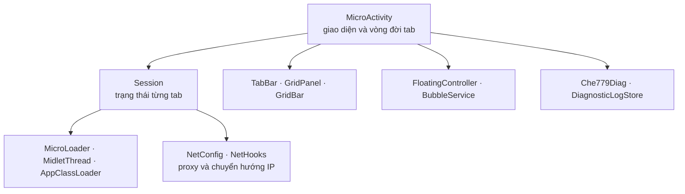

# Kiến trúc

## Mô hình chạy

Ứng dụng dựa trên **J2ME Loader 1.8.2**: phần lõi gốc lo các API MIDP/CLDC, vẽ, lưu trữ và tích hợp Android. Che779 thêm một lớp vỏ **đa phiên** bao quanh.

Mỗi `Session` là một tab đang chạy một MIDlet. Phiên giữ màn hình, hàng đợi sự kiện, bàn phím ảo, đường dẫn dữ liệu, class loader, cấu hình proxy và trạng thái giao diện của tab đó. `Session.current()` xác định phiên của luồng do game tạo ra (kế thừa từ luồng cha).

`MicroActivity` (~2.100 dòng) ghép thanh tab, chế độ lưới, cửa sổ nổi và chuyển trạng thái vòng đời. Lớp này còn lớn; nếu tách thì phải giữ nguyên thứ tự attach/detach, đổi phiên đang chọn, đóng hàng đợi sự kiện và hủy MIDlet.

| Thành phần | Trách nhiệm |
|---|---|
| `shell/Session` | Ngữ cảnh dữ liệu và trạng thái từng tab |
| `shell/MicroActivity` | Activity chính, nối giao diện với vòng đời các tab |
| `shell/MicroLoader`, `MidletThread` | Nạp MIDlet, điều phối vòng đời theo Session |
| `shell/AppClassLoader` | Class loader riêng từng game |
| `shell/NetConfig`, `org/microemu/cldc/NetHooks` | Proxy và chuyển hướng IP theo tab |
| `shell/FloatingController`, `BubbleService` | Cửa sổ game nổi và bong bóng |
| `shell/TabBar`, `GridPanel` | Thanh tab và chế độ lưới |
| `shell/Che779Diag`, `DiagnosticLogStore` | Nhật ký chẩn đoán xoay vòng |

## Tách biệt dữ liệu

- Mỗi tab có thư mục dữ liệu và class loader riêng.
- Proxy và chuyển hướng IP lưu theo khóa riêng của tab.
- Bản clone đổi `applicationId` và `DATA_DIR_NAME` nên dữ liệu tách hẳn bản gốc.
- Đóng một tab không được xóa dữ liệu tab khác, và không tự mở lại tab đã đóng.

## Nhật ký chẩn đoán

`Che779Diag` ghi vào `che779-diag.txt`; `DiagnosticLogStore` giữ file hiện tại và một thế hệ `.old`, mỗi thế hệ tối đa 3 MiB. Thread dump tối đa 3 lần mỗi phiên và 20 lần mỗi tiến trình.

## Hạn chế về sở hữu luồng

`Session.killThreads()` nhận diện luồng của game bằng cách quét stack trace tìm tên lớp do tab đó nạp. Đây **không** phải cách cách ly hoàn hảo: hai game có thể có lớp trùng tên. Đừng coi nó là ranh giới cách ly cứng.
